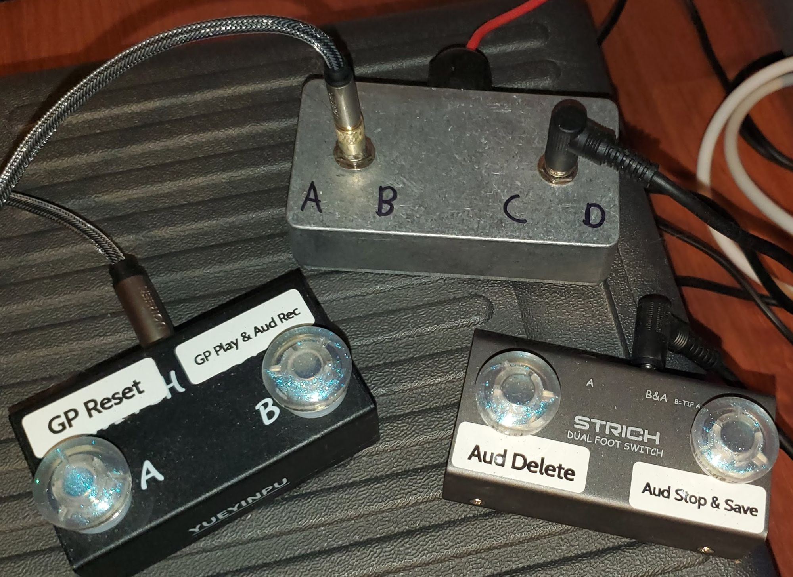
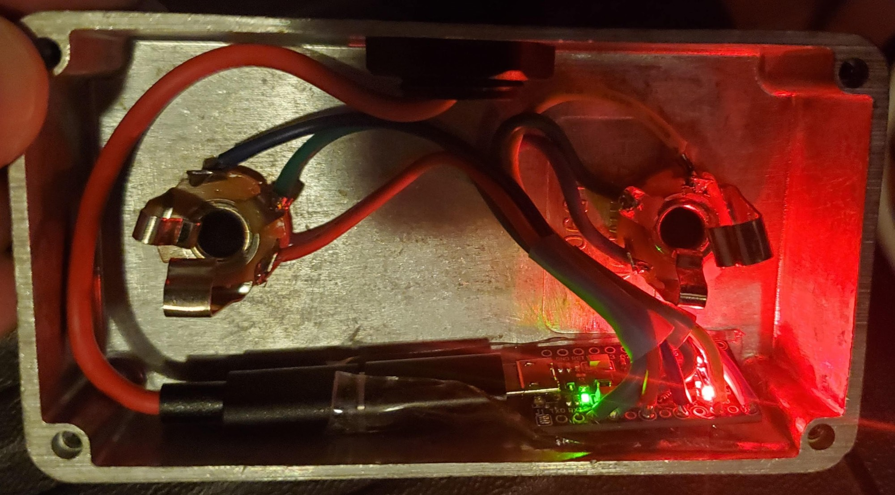

# Recording Footswitch

A four-button USB footswitch for controlling recording and playback hands-free
while playing bass guitar.

An Arduino acts as a USB keyboard. Each footswitch sends one
**Ctrl+Shift+Alt+F-key** combination. Nothing normally uses those combinations,
so an [AutoHotkey](https://www.autohotkey.com/) script can bind them to whatever
the recording workflow needs: start a take, stop and save it, throw it away,
or rewind the backing track. Both hands stay on the bass.



In the author's build, the four switches are two off-the-shelf dual
footswitches (two switches each, on one stereo cable). They plug into two
stereo jacks on a small aluminium box that holds the Arduino: one jack
carries switches A and B, the other C and D.



## Buttons

| Switch | Arduino pin | Sends | Used for in the author's setup |
|---|---|---|---|
| A | 9 | Ctrl+Shift+Alt+F12 | Reset: stop Guitar Pro playback and return to bar 1 |
| B | 7 | Ctrl+Shift+Alt+F11 | Start: arm the recorder, then start Guitar Pro playback |
| C | 5 | Ctrl+Shift+Alt+F10 | Stop: end the take, save it, run the post-processing |
| D | 3 | Ctrl+Shift+Alt+F9 | Abort: stop and discard the take |

The sketch only sends keystrokes. What each one does is decided entirely by
the AutoHotkey script on the PC, so the same pedal works with any DAW or
player.

## Hardware

- **An Arduino board with native USB**, i.e. one that can act as a USB
  keyboard (HID): an ATmega32u4 board such as the Leonardo, Micro or Pro
  Micro, or similar. Boards that use a separate USB-serial chip, like the Uno
  or Nano, cannot use the `Keyboard` library.
- **Four momentary footswitches** (normally open). Wire each one between its
  pin and GND. The sketch turns on the internal pull-ups (`INPUT_PULLUP`), so
  no resistors are needed, and a press reads `LOW`.

## Software

- Arduino IDE, with these libraries:
  - `Keyboard` (built in)
  - [`Bounce2`](https://github.com/thomasfredericks/Bounce2), from the Library
    Manager. Each switch is debounced with a 25 ms interval (`INTERVAL_MS`).
- Open `Footswitch/Footswitch.ino`, select the board, and upload.

Each press holds the full combination for 50 ms before releasing it, so
Windows reliably registers all four keys. The keys are sent once per press;
holding a switch down does not repeat it.

## Binding the keys in AutoHotkey (v2)

A minimal script to start from:

```autohotkey
#Requires AutoHotkey v2.0

^+!F12:: {   ; switch A
    MsgBox "Reset"
}
^+!F11:: {   ; switch B
    MsgBox "Start"
}
^+!F10:: {   ; switch C
    MsgBox "Stop"
}
^+!F9:: {    ; switch D
    MsgBox "Abort"
}
```

Replace each `MsgBox` with the real action, for example activating the player
window with `WinActivate` and sending `Space` with `Send "{Space}"`, or starting
a recording script with `Run`.

## Changing the keys

To send different combinations, edit the `Keyboard.press(...)` lines in each
button's block. Key names such as `KEY_F9` and `KEY_LEFT_CTRL` are listed in
the Arduino
[Keyboard modifiers reference](https://docs.arduino.cc/language-reference/en/functions/usb/Keyboard/keyboardModifiers/).

## License

Public domain, under the [Unlicense](UNLICENSE).
